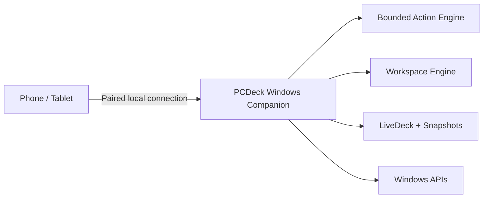

# PCDeck

### Turn any phone or tablet into an adaptive control surface for Windows.

PCDeck is a Windows companion + tablet control surface built around one idea: **your existing screen should be able to become whatever controller your current workflow needs.**

**Pre-release — public showcase and release repository. The commercial source repository is private.**

## Why PCDeck is different

PCDeck goes beyond static macro buttons:

- **AirTouch Pro** — use the tablet as a wireless mouse/touch surface
- **App Stage** — discover and launch Windows applications
- **Mission Control** — focus, minimize, maximize, and close windows remotely
- **Workspace Engine** — launch apps, arrange windows, change tablet layouts, and apply volume presets in one tap
- **LiveDeck** — live app controls, system telemetry, audio mixing, media controls, and desktop Snapshot/Restore
- **Layout Studio** — build tablet-specific pages, folders, docks, widgets, and responsive portrait/landscape layouts
- **Flow + NeuralDeck** — local context switching and opt-in workflow suggestions
- **Fusion + QuickDrop** — move files and clipboard content between the tablet and PC
- **Local-first security** — paired devices, bounded APIs, opaque app IDs, rate limiting, and no generic remote shell

## The 30-second demo

1. Tap **Development Workspace** on the tablet.
2. Watch Windows apps launch and arrange themselves.
3. Move the PC pointer using **AirTouch**.
4. Adjust per-app volume from **LiveDeck**.
5. Capture a desktop snapshot, scramble the windows, then restore everything with one tap.
6. Open **Layout Studio** and rearrange the tablet UI live.

See [`docs/DEMO-SCRIPT.md`](docs/DEMO-SCRIPT.md).

## Architecture

More detail: [`docs/ARCHITECTURE.md`](docs/ARCHITECTURE.md).

## Security philosophy

PCDeck intentionally keeps sensitive capabilities on the Windows companion. Tablet clients use authenticated, bounded actions and opaque IDs rather than receiving executable paths or a remote shell. See [`SECURITY.md`](SECURITY.md).

## Releases

Signed Early Access binaries and installation instructions will appear in GitHub Releases when the commercial beta opens.

## Pricing / Early Access

See [`BUY.md`](BUY.md).

## For employers / technical reviewers

The private engineering repository currently contains the Windows companion, responsive tablet UI, automated tests, networking/pairing layer, workspace/window engine, audio/media controls, app discovery, and LiveDeck. Source access can be provided privately for legitimate technical review.

## Status

PCDeck is an independent software project in active development. It is not affiliated with Elgato, Touch Portal, Microsoft, or other third-party products mentioned for comparison.
## 🎬 See PCDeck in action

**30-second product showcase — AirTouch, tablet controls, apps, automation and more.**
